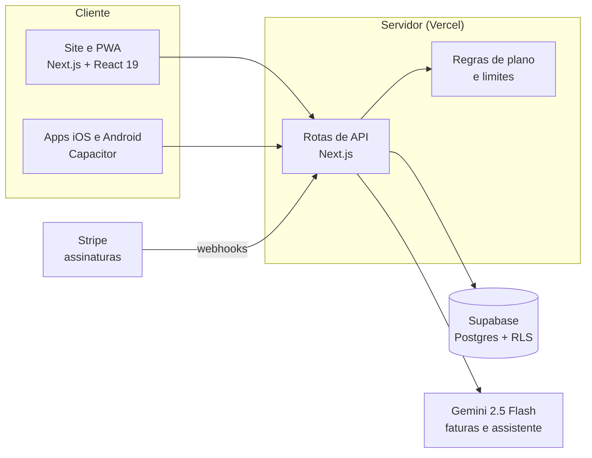

  

<h1 align="center">Dinzelo</h1>

  Controle financeiro com IA para quem quer fechar o mês com folga, sozinho ou a dois. 
  <a href="https://dinzelo.app"><strong>dinzelo.app</strong></a>

  
  
  
  
  
  
  

> Este repositório é a vitrine do projeto. O código-fonte é privado.

---

## O que é

O Dinzelo organiza contas, cartões e parcelas, repete o que é recorrente e mostra como vão ser os próximos meses. Foi pensado para o jeito brasileiro de lidar com dinheiro: compras parceladas, várias faturas de cartão e um orçamento que muitas vezes é dividido pelo casal.

  

## Principais recursos

| | |
|---|---|
| **Importar fatura** | A pessoa envia o PDF ou um print da fatura. A IA encontra as compras, monta o cartão (final, limite, fechamento, vencimento), separa as parcelas e confere a soma com o total da fatura. Nada é lançado antes da revisão, e o arquivo não é guardado. |
| **Visão do mês** | Quanto sobra, o que já foi pago, o que falta pagar e quanto da renda está comprometido. Os cards do painel podem ser reorganizados. |
| **Cartões e parcelas** | Fatura do mês, limite comprometido, parcelas restantes e quando cada uma termina. |
| **Economize** | Encontra assinaturas esquecidas, tarifas, anuidade, juros e parcelas que estão acabando, sempre ordenados pelo quanto a pessoa economiza por ano. |
| **Espaços compartilhados** | O casal ou a família lança no mesmo espaço, cada um com seu login e com um espaço pessoal privado. |
| **Planejamento** | Orçamento por categoria, metas e regra 50/30/20. |
| **Comparativo e projeção** | Evolução mês a mês e projeção do ano com base nas contas fixas e nas parcelas. |
| **Assistente com IA** | Perguntas em linguagem natural sobre os próprios gastos. |
| **App para iPhone e Android** | Mesma base de código, com ajustes visuais de cada plataforma. |

  

  

## Como foi construído

**Stack:** Next.js 16 (App Router), React 19, TypeScript, Tailwind CSS e shadcn/ui, TanStack Query e Zustand, Recharts, Supabase (autenticação e Postgres), Google Gemini, Stripe Billing, Capacitor, Sentry e Vercel.

## Decisões técnicas

- **Segurança dos dados no banco.** Todas as tabelas usam Row Level Security no Postgres: cada pessoa só lê e grava o que é dela, e nos espaços compartilhados só os membros têm acesso. As regras foram testadas em um Postgres local antes de ir para produção.
- **IA com custo sob controle.** Limite mensal de perguntas por plano, raciocínio do modelo desligado onde não é necessário, histórico de conversa enxuto e cache do resumo mensal, que só é refeito quando os dados mudam. A leitura de uma fatura custa poucos centavos.
- **IA só onde faz diferença.** A seção Economize funciona com regras determinísticas, sem custo de IA. Depois que a pessoa escolhe a categoria de um estabelecimento, as próximas faturas já vêm categorizadas sem chamar o modelo.
- **Privacidade das faturas.** O arquivo é processado em memória e descartado. O app guarda só as compras que a pessoa confirma.
- **Assinaturas confiáveis.** Os limites de cada plano são checados no servidor. O estado da assinatura chega por webhooks do Stripe com verificação de assinatura, incluindo renovação, cobrança recusada, contestação e alerta de fraude. O teste grátis de 10 dias não pede cartão.
- **Séries mensais.** Contas fixas e parcelas são séries: cada mês tem a própria ocorrência, o que permite marcar "pago" mês a mês sem duplicar lançamentos.
- **Interface adaptada a cada plataforma.** Variantes de estilo para iOS e Android, área segura do notch, resposta tátil (haptics) e um modo de privacidade que esconde os valores na tela.

## Planos

| Grátis | Plus | Casa |
|---|---|---|
| Despesas, rendas e contas fixas, 1 cartão, 1 fatura importada por mês | Faturas e cartões ilimitados, assistente com IA, orçamentos, metas e projeção anual | Tudo do Plus para até 5 pessoas, com espaço compartilhado |

Toda conta nova começa com 10 dias de teste com todos os recursos liberados.

## Autor

**Thiago Alves**: produto, design e desenvolvimento.

- Site do projeto: [dinzelo.app](https://dinzelo.app)
- LinkedIn: _adicione o seu link_
- E-mail: _adicione o seu contato_

---

As telas mostram uma conta de demonstração com dados fictícios. Marca, imagens e textos © Thiago Alves. Todos os direitos reservados.
