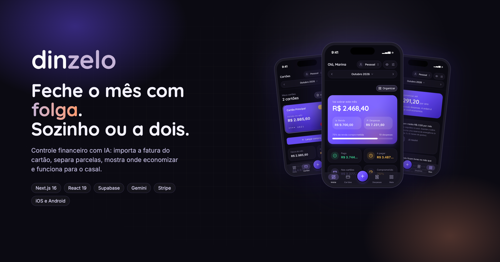
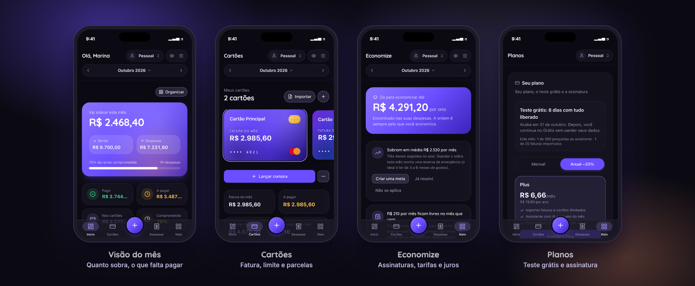
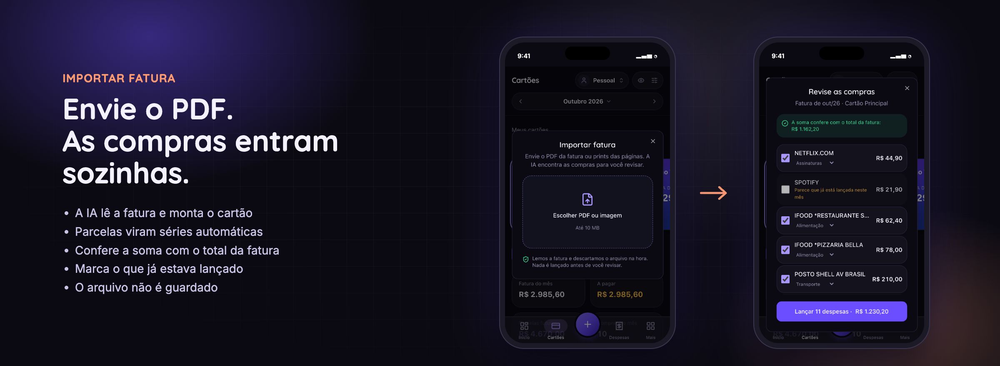
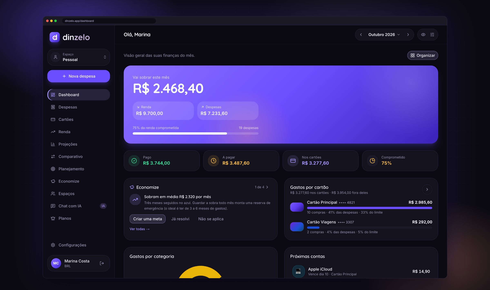
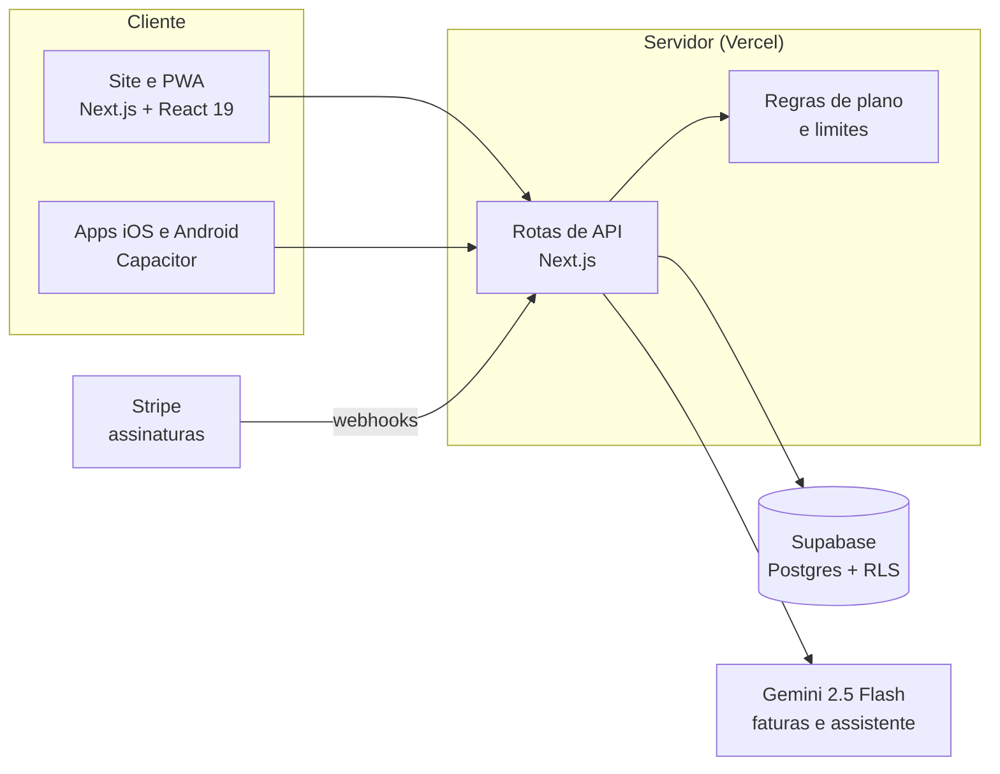
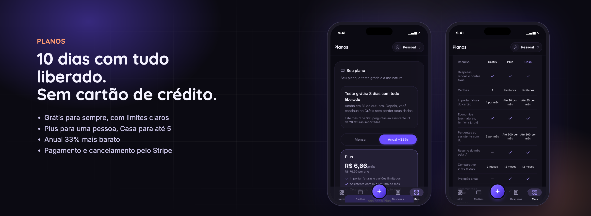

  

<h1 align="center">Dinzelo</h1>

  Controle financeiro com IA para quem quer fechar o mês com folga, sozinho ou a dois. 
  <a href="https://dinzelo.app"><strong>dinzelo.app</strong></a>

  
  
  
  
  
  
  

> **Sobre este repositório:** esta é a vitrine do projeto, com imagens, recursos e decisões de arquitetura. O código-fonte do produto é privado.

---

## Sumário

- [O problema](#o-problema)
- [Para quem é](#para-quem-é)
- [Como funciona](#como-funciona)
- [Principais recursos](#principais-recursos)
- [Como foi construído](#como-foi-construído)
- [Decisões técnicas](#decisões-técnicas)
- [Qualidade e testes](#qualidade-e-testes)
- [Planos e modelo de negócio](#planos-e-modelo-de-negócio)
- [Próximos passos](#próximos-passos)
- [Autor](#autor)

---

## O problema

Controlar dinheiro no Brasil tem particularidades que planilhas e apps estrangeiros não resolvem bem:

- **Parcelas por todo lado.** Uma compra de hoje pesa no orçamento pelos próximos 10 meses, e é fácil perder a conta do que já está comprometido.
- **Várias faturas de cartão.** Cada uma fecha e vence num dia, e lançar compra por compra à mão cansa. Esse é o principal motivo para as pessoas abandonarem apps de finanças.
- **Dinheiro do casal.** As contas da casa são divididas, mas cada um tem sua vida financeira. Planilha compartilhada vira confusão, e ninguém sabe quem lançou o quê.

## Para quem é

- Quem usa **cartão de crédito com frequência** e quer saber quanto da renda já está comprometido com parcelas.
- **Casais e famílias** que dividem as contas da casa e querem um espaço comum sem abrir mão da privacidade de cada um.
- Quem **já tentou planilha** e desistiu por falta de tempo.

## Como funciona

1. **Envie a fatura do cartão.** PDF ou print: a IA lê as compras, monta o cartão e separa as parcelas. A pessoa revisa e confirma.
2. **Veja o mês e os próximos.** Quanto sobra, o que falta pagar, quando cada parcela acaba e como fica o ano.
3. **Ajuste o rumo.** O Economize aponta assinaturas esquecidas, tarifas e juros; o Planejamento traz orçamentos por categoria e metas.

  

## Principais recursos

| Recurso | O que faz |
|---|---|
| **Importar fatura** | Lê PDF ou imagem da fatura com IA, monta o cartão (final, limite, fechamento e vencimento), lança as compras, transforma "03/10" em série parcelada, marca o que já estava lançado e confere a soma com o total impresso na fatura. Nada é lançado antes da revisão, e o arquivo é descartado. |
| **Visão do mês** | Cumprimenta pelo nome e mostra o saldo previsto, pago e a pagar, total nos cartões e percentual da renda comprometido. Os cards do painel podem ser reorganizados arrastando, inclusive pelo teclado. |
| **Cartões e parcelas** | Fatura do mês, limite comprometido, parcelas restantes e o mês em que cada uma termina. |
| **Economize** | Encontra assinaturas somadas, tarifas e anuidade, juros e IOF, parcelas que acabam e sobra frequente, ordenados pelo quanto a pessoa economiza por ano. Cada dica pode ser marcada como "Já resolvi" ou "Não se aplica". |
| **Espaços compartilhados** | O casal ou a família lança no mesmo espaço por convite com link. Cada um mantém seu login e um espaço pessoal privado, e o app mostra quem lançou o quê. |
| **Planejamento** | Orçamento mensal por categoria, metas com prazo e referência da regra 50/30/20. |
| **Comparativo e projeção** | Evolução de renda, despesas e saldo mês a mês, e projeção do ano com contas fixas, parcelas e média dos gastos variáveis. |
| **Assistente com IA** | Perguntas em linguagem natural sobre os próprios dados, como "onde posso economizar este mês?". |
| **Planos** | Página própria com o plano atual, os dias restantes do teste, o uso do mês, a assinatura pelo Stripe e uma tabela comparando o que cada plano inclui. |
| **Modo privacidade** | Esconde os valores na tela com um toque, útil em lugar público. |
| **Apps para iPhone e Android** | Mesma base de código, com acabamento de cada plataforma: área segura do notch, resposta tátil e estilos próprios. |

  

  

## Como foi construído

| Camada | Tecnologias |
|---|---|
| Interface | Next.js 16 (App Router), React 19, TypeScript, Tailwind CSS, shadcn/ui, Recharts, dnd-kit |
| Estado e dados | TanStack Query, Zustand, React Hook Form e Zod |
| Back-end | Rotas de API do Next.js na Vercel, Supabase (autenticação e Postgres com RLS) |
| Inteligência artificial | Google Gemini 2.5 Flash, com saída estruturada por JSON Schema |
| Pagamentos | Stripe Billing: Checkout, portal do cliente e webhooks |
| Mobile | Capacitor 8 (iOS e Android), PWA instalável |
| Observabilidade | Sentry e Vercel Analytics |

## Decisões técnicas

**Segurança dos dados no próprio banco.** Todas as tabelas usam Row Level Security no Postgres: cada pessoa só lê e grava o que é dela, e nos espaços compartilhados só os membros têm acesso. Mesmo que uma rota de API tivesse um erro, o banco não entregaria dados de outra pessoa. As regras foram testadas num Postgres local antes de ir para produção.

**IA com custo previsível.**
- Limite mensal de perguntas por plano, mais um limite por hora contra uso automatizado.
- "Raciocínio" do modelo desligado onde não faz diferença, porque ele é cobrado como saída, a parte mais cara.
- Histórico de conversa enxuto e cache do resumo mensal, que só é refeito quando os dados mudam.
- Resultado: ler uma fatura custa poucos centavos, e o pior caso por usuário tem teto conhecido.

**IA só onde ela faz diferença.** O Economize funciona com regras determinísticas, sem custo de IA. Depois que a pessoa escolhe a categoria de um estabelecimento, as próximas faturas já chegam categorizadas sem chamar o modelo.

**Confiança na leitura da fatura.** A resposta da IA segue um JSON Schema fixo. O app confere a soma das compras com o total impresso, separa estornos, ignora o pagamento da fatura anterior e marca possíveis duplicadas. A revisão é obrigatória antes de qualquer lançamento.

**Privacidade (LGPD).** A fatura é processada em memória e descartada. Ficam guardadas só as compras que a pessoa confirma.

**Assinaturas robustas.**
- Os limites de cada plano são checados no servidor, nunca só na tela.
- O estado da assinatura chega por webhooks do Stripe com verificação de assinatura: criação, renovação, cobrança recusada (com período de tolerância), cancelamento, contestação e alerta de fraude (reembolso automático).
- O teste grátis de 10 dias não pede cartão. Quem assina durante o teste só é cobrado quando ele acaba.
- Ao fim do teste ninguém perde dados: o que passa do limite gratuito fica arquivado, e o histórico continua intacto.

**Modelo de séries mensais.** Contas fixas e parcelas são séries: cada mês tem a própria ocorrência, criada sob demanda. Isso permite marcar "pago" mês a mês, encerrar uma série a partir de um mês e evitar duplicatas com índices únicos no banco.

**Uma base de código, três plataformas.** O app nativo carrega a mesma aplicação web e ganha, conforme a plataforma, estilo próprio (iOS ou Android), área segura do notch e resposta tátil.

## Qualidade e testes

- **Ponta a ponta com Playwright:** importação de fatura (leitura em cerca de 10 segundos, soma conferida com o total), fluxo de assinatura, portal do cliente e cobrança recusada no ambiente de testes do Stripe.
- **Regras de acesso do banco** testadas num Postgres local (PGlite): ninguém lê dados de outra pessoa nem consegue se dar um plano pago sozinho.
- **Concorrência:** proteção contra registros duplicados quando o primeiro acesso acontece em paralelo, com teste de acessos simultâneos.
- **TypeScript em modo estrito** e validação com Zod em todas as entradas da API.

## Planos e modelo de negócio

| Grátis | Plus | Casa |
|---|---|---|
| Despesas, rendas e contas fixas | Tudo do Grátis | Tudo do Plus para até 5 pessoas |
| 1 cartão | Cartões ilimitados | Espaço compartilhado com convite |
| 1 fatura importada por mês | Faturas importadas sem limite prático | Login próprio para cada pessoa |
| 5 perguntas por mês ao assistente | Assistente e resumo do mês com IA | Metas e orçamentos da casa |
| Comparativo de 3 meses | Orçamentos, metas e projeção anual | |

Toda conta nova começa com **10 dias de teste com tudo liberado**, sem cartão de crédito. O plano anual sai 33% mais barato.

  

## Próximos passos

- [ ] Publicação na App Store e no Google Play
- [ ] Conexão automática com bancos via Open Finance
- [ ] Parcerias no Economize (sempre identificadas e ordenadas pela economia, nunca pela comissão)
- [ ] Relatório para a declaração do Imposto de Renda
- [ ] Aviso por e-mail antes do vencimento das contas

## Autor

**Thiago Alves**: produto, design de interface e desenvolvimento de ponta a ponta, da identidade visual à cobrança.

- Site do projeto: [dinzelo.app](https://dinzelo.app)
- LinkedIn: _adicione o seu link_
- E-mail: _adicione o seu contato_

---

As telas mostram uma conta de demonstração com dados fictícios. Marca, imagens e textos © Thiago Alves. Todos os direitos reservados.
